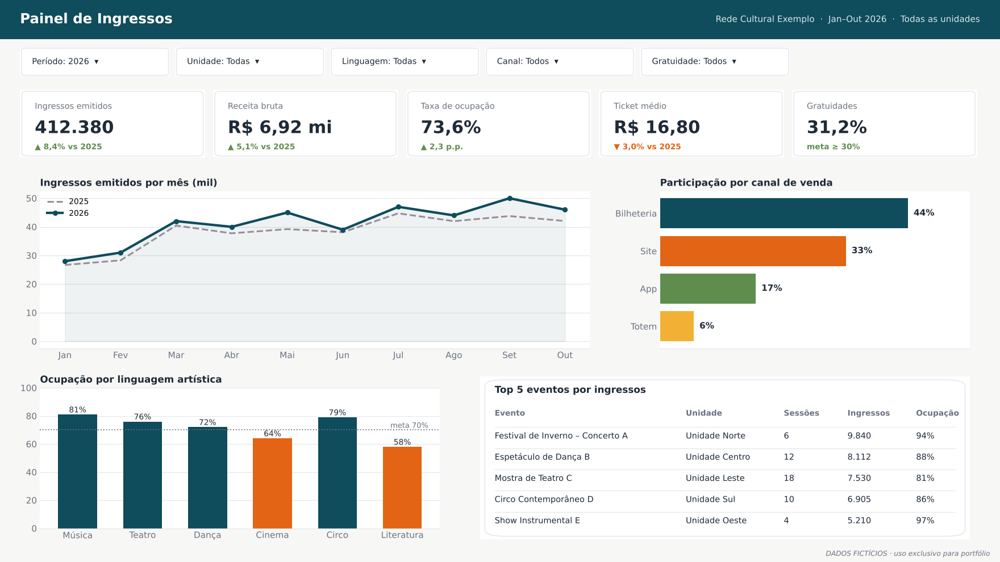
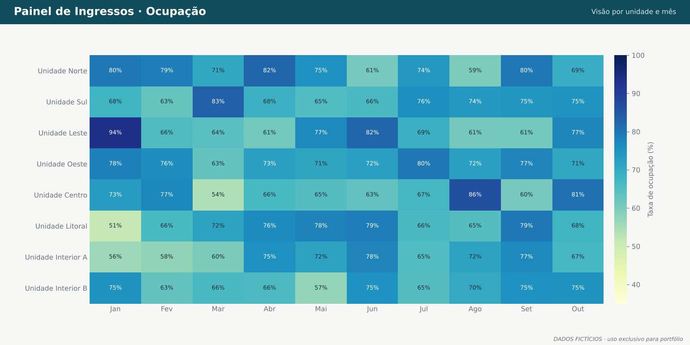

# 01 · Painel de Ingressos

> Painel em Power BI para acompanhar a venda de ingressos, a ocupação das salas e o volume de gratuidades em uma rede de centros culturais.
> *Recriado com dados fictícios. Os nomes de unidades e eventos são genéricos.*



## O problema

A gerencia responsável precisava responder com rapidez a perguntas como:

- Quais linguagens artísticas estão abaixo da meta de ocupação?
- Quantidade de eventos em unidades especificas?
- Receitas de unidades e eventos?
- Quantidade de cortesias estão abaixo ou acima da média?

Antes, essas respostas dependiam de planilhas exportadas manualmente do sistema de bilheteria e consolidadas a cada mês.

## A solução

| Página | O que mostra |
|--------|--------------|
| **Visão geral** | KPIs do período com comparação ao ano anterior, evolução mensal, canais de venda, ocupação por linguagem e ranking de eventos |
| **Ocupação** | Mapa de calor por unidade e mês, para identificar sazonalidade e unidades com ociosidade |
| **Detalhe por sessão** | Tabela com cada sessão e as vendas por canal, para conferência com a bilheteria |



## Destaques técnicos

- **Modelo em esquema estrela:** uma tabela fato de vendas e dimensões de sessão, evento, unidade, canal e calendário. [Veja o modelo](../06-consultas-sql/imagens/modelo-dados.png).
- **Medidas DAX reutilizáveis:** comparação com o ano anterior (`SAMEPERIODLASTYEAR`), taxa de ocupação (`DIVIDE` pela capacidade) e participação percentual com `ALLSELECTED`.
- **Segurança por linha (RLS):** cada gestor de unidade vê apenas os dados da própria unidade.
- **Cartões de KPI customizados** em HTML, com o indicador de variação colorido conforme a meta.
- **Documentação completa:** dicionário de medidas e manual do usuário, gerados automaticamente. [Veja o projeto 03](../03-agente-documentacao/).

```DAX
Taxa de Ocupação =
DIVIDE ( [Ingressos Emitidos], SUM ( dSessao[Capacidade] ) )

Var % Ano Anterior =
VAR atual = [Ingressos Emitidos]
VAR anterior =
    CALCULATE ( [Ingressos Emitidos], SAMEPERIODLASTYEAR ( dCalendario[Data] ) )
RETURN
    DIVIDE ( atual - anterior, anterior )
```

## Resultado

- ✏️ *Substitua pelo seu resultado real, sem dados sigilosos. Exemplo: "Substituiu a consolidação manual mensal de X planilhas" ou "Usado por N unidades/gestores".*
- ✏️ *Exemplo: "Reduziu de X dias para poucos minutos o tempo de conciliação entre o sistema de bilheteria e o financeiro".*

## Ferramentas

`Power BI` · `DAX` · `Power Query (M)` · `RLS` · `SQL`
