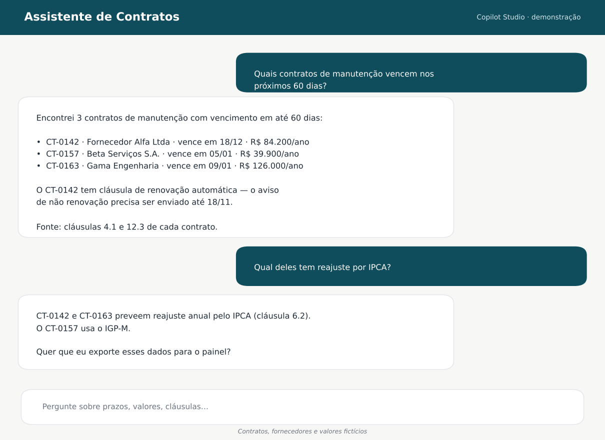
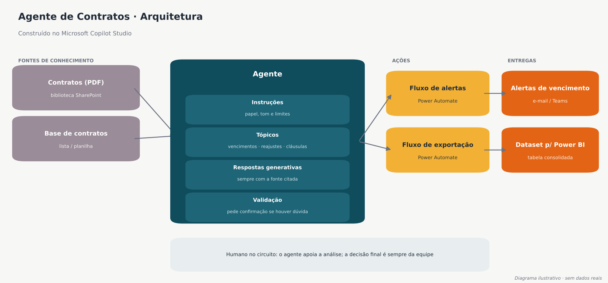
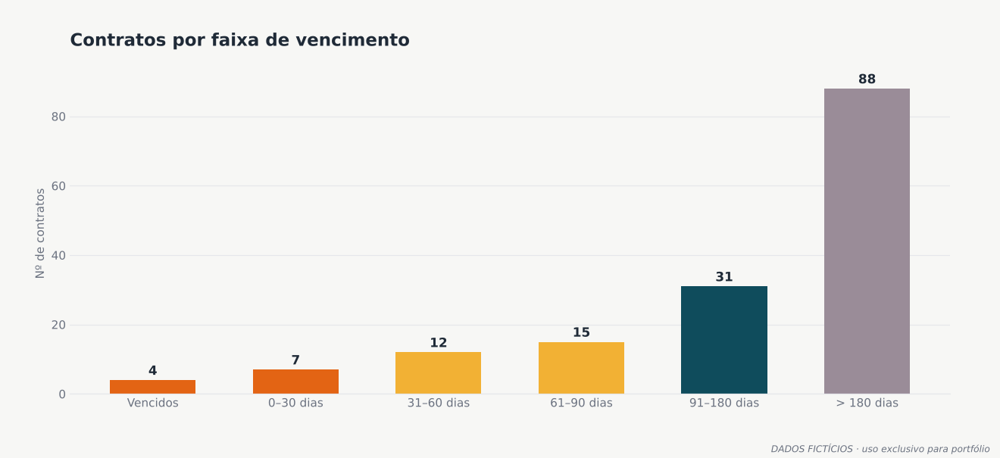

# 02 · Agente de Contratos

> Agente de IA criado no **Microsoft Copilot Studio** que consulta a base de contratos e responde em linguagem natural sobre busca por contratos, valores, sempre citando a fonte.
> *A demonstração usa contratos, fornecedores e valores fictícios.*

## Resultado

> ⏱️ **Redução de 87,5% no tempo de análise.** Análises que levavam **2 dias** passaram a levar **no máximo 2 horas**.

## O problema

A gestão de contratos envolvia diversas fontes. Perguntas simples exigiam consultas a diversos sistemas, por exemplo:

- *"Quantos contratos temos com a empresa X?"*
- *"Qual valores de pagamentos fizemos a empresa Y?"*
- *"Poderia fazer um relatório com as informações de contrato da empresa W?"*

Cada análise levava cerca de dois dias de trabalho. O risco mais caro era **demorar para ter a informação para a tomada de decisão**.

## A solução

| Componente (Copilot Studio) | Função |
|---|---|
| **Fontes de conhecimento** | Base de contratos, pagamentos em uma planilha vinculada a um fluxo de dados |
| **Instruções** | Definem o papel do agente, o tom e os limites. Ele não inventa informações e sempre cita a cláusula de origem |
| **Tópicos** | Fluxos guiados para as perguntas mais comuns: vencimentos, reajustes e cláusulas específicas |
| **Respostas generativas** | Atendem perguntas livres sobre o conteúdo dos contratos |

## Decisões de projeto

- **Resposta sempre com a fonte:** o agente cita o contrato e a cláusula, para que a pessoa confira antes de agir.
- **Tópicos para o que é recorrente:** as perguntas mais frequentes seguem um fluxo fixo, e o resultado fica previsível.
- **Humano no circuito:** o agente acelera a análise, mas a decisão continua com a equipe.

## Ferramentas

`Microsoft Copilot Studio` · `Power Automate` · `SharePoint` · `Power BI`

Cálculo: 2 dias úteis ≈ 16 horas → 2 horas = redução de 87,5%.
