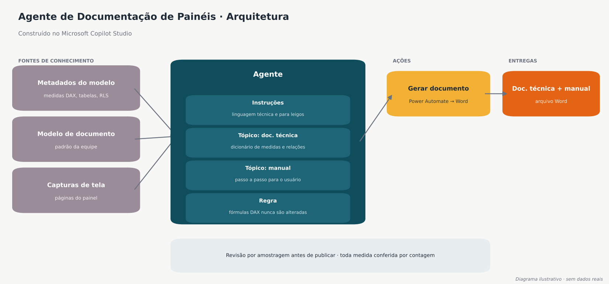
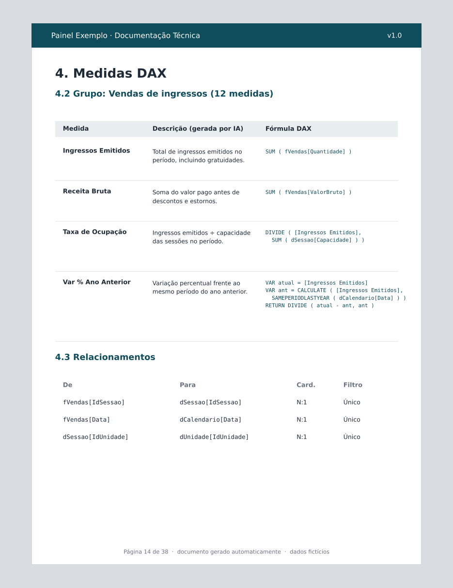

# 03 · Agente de Documentação de Painéis

> Agente de IA criado no **Microsoft Copilot Studio** que lê os metadados de um modelo Power BI e gera a documentação técnica e o manual do usuário.
> *O exemplo usa um painel fictício.*

## Resultado

> ⏱️ **Redução de 87,5% no tempo de documentação.** Um trabalho que levava **2 dias** passou a levar **no máximo 2 horas**.

## O problema

Painéis com centenas de medidas DAX, várias tabelas e regras de acesso ficam rapidamente sem documentação. Escrever tudo à mão levava cerca de dois dias por painel e desatualizava na primeira mudança. Sem documentação:

- a passagem de conhecimento depende de quem construiu o painel;
- usuários de negócio não entendem o que cada indicador significa.

## A solução

| Componente (Copilot Studio) | Função |
|---|---|
| **Fontes de conhecimento** | Metadados exportados do modelo (medidas DAX, tabelas, relacionamentos e RLS), o modelo de documento da equipe e capturas de tela do painel |
| **Instruções** | Escrever em dois registros: técnico, para analistas, e simples, para usuários de negócio |
| **Tópico: documentação técnica** | Dicionário de medidas agrupado por tema, relacionamentos, regras de acesso e consultas Power Query |
| **Tópico: manual do usuário** | Passo a passo de navegação, filtros e o significado de cada indicador |
| **Ação (Power Automate)** | Monta o documento final em Word a partir do modelo padrão |

## Regras de qualidade

- ✅ Toda medida do modelo aparece no documento (conferência por contagem).
- ✅ As fórmulas DAX são copiadas sem nenhuma alteração. O agente só escreve a descrição.
- ✅ As descrições geradas passam por revisão por amostragem antes da publicação.

## Ferramentas

`Microsoft Copilot Studio` · `Power Automate` · `Power BI` · `SharePoint`

Cálculo: 2 dias úteis ≈ 16 horas → 2 horas = redução de 87,5%.
