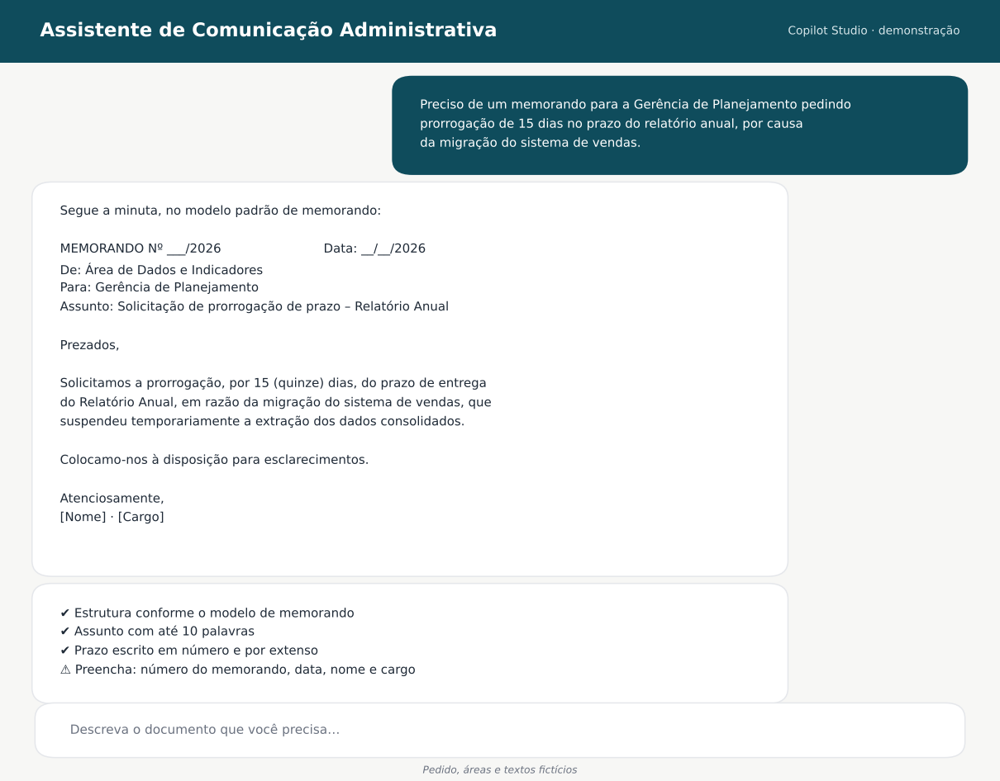
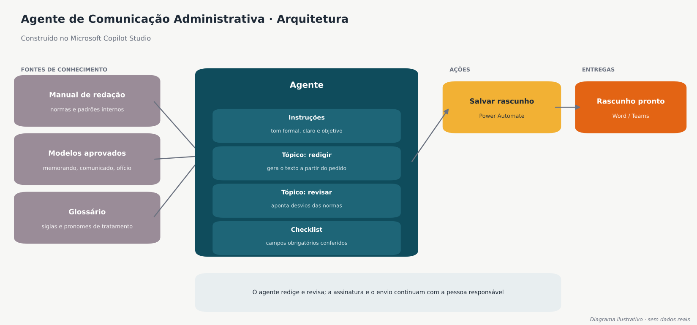
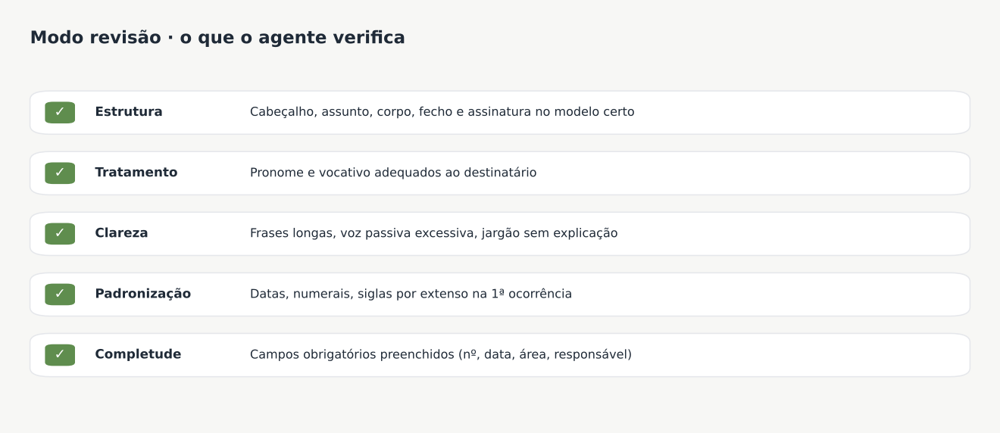

# 04 · Agente de Comunicação Administrativa

> Agente de IA criado no **Microsoft Copilot Studio** para redigir e revisar comunicações administrativas (memorandos, comunicados e ofícios) seguindo o manual de redação e os modelos oficiais da instituição.
> *A demonstração usa pedidos, áreas e textos fictícios.*

## O problema

Em uma instituição grande, as comunicações internas e externas seguem um padrão formal: estrutura, pronomes de tratamento, numeração e fechos. Na prática:

- cada pessoa redigia de um jeito, e os documentos voltavam para correção;
- consultar o manual de redação a cada documento tomava tempo;
- erros simples, como campo obrigatório vazio ou tratamento inadequado, passavam despercebidos.
- saber quantos documentos estão em sua fila para aprovação ou revisão.

## A solução

O agente usa como **fontes de conhecimento** correção ortográfica e sugestões usando um modelo de IA, os modelos aprovados e um glossário de siglas e pronomes de tratamento. Ele funciona em dois modos:

| Modo | O que faz |
|------|-----------|
| **Redigir** | A pessoa descreve o que precisa em linguagem natural e recebe uma minuta pronta no modelo certo |
| **Revisar** | A pessoa cola um texto e recebe os desvios das normas apontados, com sugestão de correção |

## Decisões de projeto

- **Respostas ancoradas nas normas:** o agente segue o manual e os modelos oficiais, e não um "estilo" genérico.
- **Checklist explícito:** toda minuta termina com o que foi conferido e o que ainda falta preencher.
- **Humano no circuito:** o agente redige e revisa, mas a assinatura e o envio continuam com a pessoa responsável.

## Resultado

- ✏️ *Preencha com um número real. Por exemplo: "Tempo de redação de um memorando caiu de X para Y minutos" ou "Redução de Z% nas devoluções para correção".*

## Ferramentas

`Microsoft Copilot Studio` · `Power Automate` · `SharePoint` · `Microsoft Teams`
