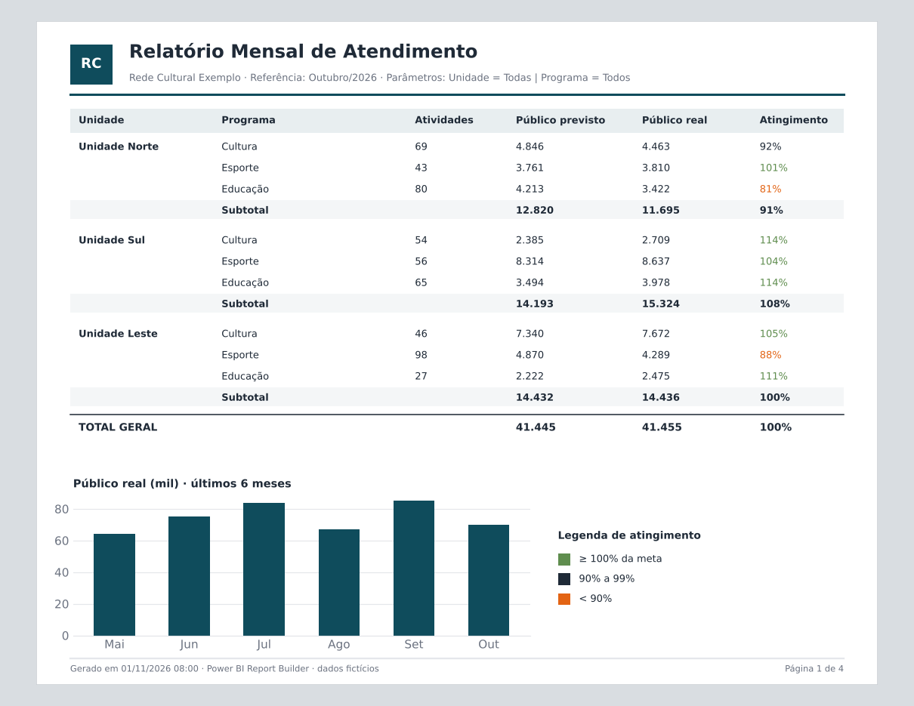
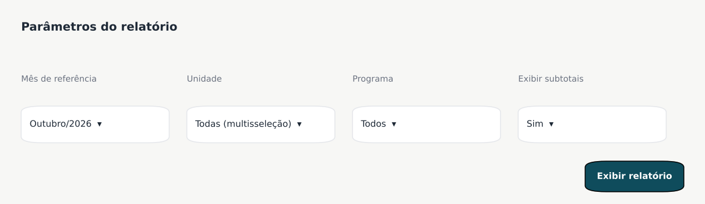

# 05 · Relatórios Paginados (Power BI Report Builder)

> Relatórios mensais em formato de página, prontos para impressão, exportação em PDF ou Excel e envio automático por e-mail.
> *Recriado com dados fictícios.*



## Por que relatório paginado, e não um painel?

Painéis são ótimos para explorar dados. Alguns públicos, porém, precisam de um **documento fechado**:

- a diretoria, que recebe o mesmo formato todo mês;
- a prestação de contas, que exige tabelas completas sem rolagem;
- pessoas que preferem receber o relatório por e-mail, sem acessar o Power BI.

## O que o relatório tem

- **Parâmetros:** mês de referência, unidade (com multisseleção), programa e exibição de subtotais.
- **Agrupamento** por unidade e programa, com subtotais e total geral.
- **Formatação condicional:** o atingimento da meta aparece em verde (≥ 100%), neutro (90% a 99%) ou laranja (< 90%).
- **Gráfico de tendência** com os últimos 6 meses.
- **Cabeçalho e rodapé** com os parâmetros usados, a data de geração e a numeração de páginas.
- **Assinatura agendada** no serviço do Power BI para envio mensal em PDF.



## Consulta base (exemplo)

```sql
SELECT
    u.nome_unidade,
    p.nome_programa,
    COUNT(DISTINCT a.id_atividade)  AS atividades,
    SUM(a.publico_previsto)         AS publico_previsto,
    SUM(a.publico_real)             AS publico_real
FROM fato_atividade a
JOIN dim_unidade  u ON u.id_unidade  = a.id_unidade
JOIN dim_programa p ON p.id_programa = a.id_programa
WHERE a.data_atividade >= @DataInicio
  AND a.data_atividade <  @DataFim
  AND u.id_unidade IN (@Unidade)
GROUP BY u.nome_unidade, p.nome_programa
ORDER BY u.nome_unidade, p.nome_programa;
```

> O atingimento (`publico_real / publico_previsto`) é calculado no próprio relatório. Assim, os subtotais e o total geral usam a razão das somas, e não a média das porcentagens.

## Resultado

- ✏️ *Exemplo: "Substituiu N relatórios montados manualmente em Excel todo mês".*

## Ferramentas

`Power BI Report Builder` · `SQL` · `Power BI Service (assinaturas)`
