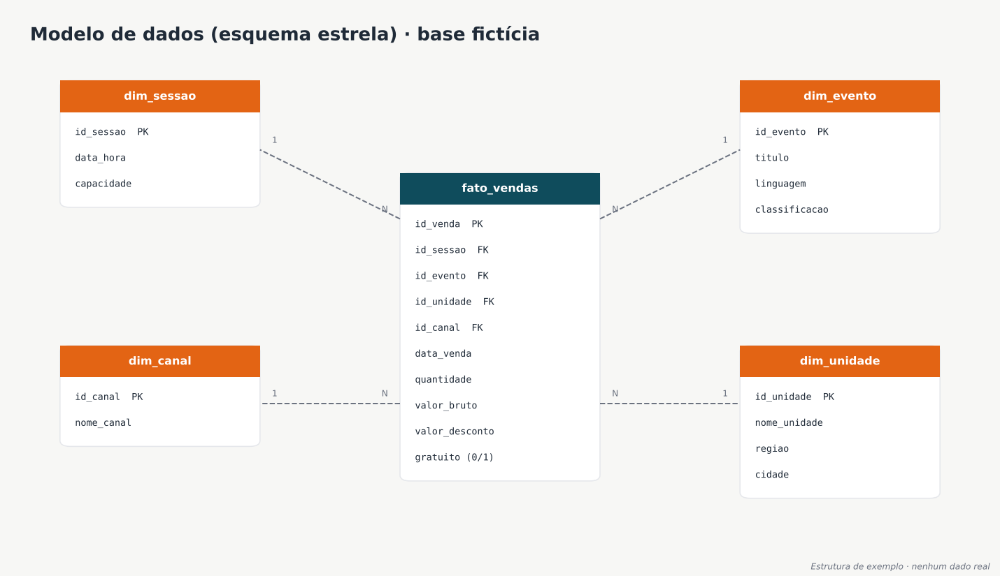

# 06 · Consultas SQL de Negócio

> Oito consultas que respondem a perguntas reais de gestão sobre uma base de vendas de ingressos. Os exemplos vão do básico (JOIN, GROUP BY) a CTEs e funções de janela.
> *A base é 100% fictícia: 5 unidades, 7 eventos e 135 transações de venda.*



## Como executar

Os scripts rodam em **SQLite** sem instalar nada além do Python. Também funcionam em PostgreSQL e SQL Server com pequenos ajustes nas funções de data.

```bash
sqlite3 ingressos.db < 01_criar_tabelas.sql
sqlite3 ingressos.db < 02_inserir_dados.sql
sqlite3 -header -column ingressos.db < 03_consultas.sql
```

| Arquivo | Conteúdo |
|---------|----------|
| [`01_criar_tabelas.sql`](01_criar_tabelas.sql) | Criação do esquema estrela (1 fato + 4 dimensões) |
| [`02_inserir_dados.sql`](02_inserir_dados.sql) | Dados fictícios |
| [`03_consultas.sql`](03_consultas.sql) | As 8 consultas comentadas |

---

## Perguntas e respostas

### Q1 · Ingressos e receita por unidade
`JOIN` · `GROUP BY` · `SUM`

| nome_unidade | ingressos | receita_liquida |
|---|---:|---:|
| Unidade Interior | 1.401 | 21.348,50 |
| Unidade Norte | 1.209 | 10.230,00 |
| Unidade Leste | 773 | 3.252,00 |
| Unidade Sul | 583 | 7.118,00 |
| Unidade Litoral | 309 | 5.340,00 |

### Q2 · Participação por canal de venda
`subconsulta` · `percentual sobre o total`

| nome_canal | ingressos | participacao_pct |
|---|---:|---:|
| Bilheteria | 1.936 | 45,3 |
| Site | 1.665 | 38,9 |
| App | 446 | 10,4 |
| Totem | 228 | 5,3 |

### Q3 · Meta de gratuidade (≥ 30%)
`CASE WHEN` dentro de agregação

| total_ingressos | gratuitos | gratuidade_pct | status_meta |
|---:|---:|---:|---|
| 4.275 | 1.890 | 44,2 | Meta atingida |

### Q4 · Ocupação por linguagem artística
`CTE` · agregação em dois níveis

```sql
WITH vendas_por_sessao AS (
    SELECT id_sessao, id_evento, SUM(quantidade) AS vendidos
    FROM fato_vendas
    GROUP BY id_sessao, id_evento
)
SELECT e.linguagem,
       ROUND(100.0 * SUM(vs.vendidos) / SUM(s.capacidade), 1) AS ocupacao_pct
FROM vendas_por_sessao vs
JOIN dim_sessao s ON s.id_sessao = vs.id_sessao
JOIN dim_evento e ON e.id_evento = vs.id_evento
GROUP BY e.linguagem
ORDER BY ocupacao_pct DESC;
```

| linguagem | ingressos | capacidade | ocupacao_pct |
|---|---:|---:|---:|
| Cinema | 1.174 | 1.350 | 87,0 |
| Literatura | 1.021 | 1.350 | 75,6 |
| Música | 500 | 740 | 67,6 |
| Teatro | 343 | 520 | 66,0 |
| Circo | 790 | 1.200 | 65,8 |
| Dança | 447 | 740 | 60,4 |

> 💡 **Cuidado comum:** juntar a tabela de vendas diretamente com a de sessões e somar `capacidade` conta a mesma sessão várias vezes, uma para cada venda. A CTE agrega as vendas por sessão antes do JOIN e evita esse erro.

### Q5 · Evolução mensal
Tratamento de datas

| mes | transacoes | ingressos |
|---|---:|---:|
| 2026-06 | 19 | 658 |
| 2026-07 | 53 | 1.663 |
| 2026-08 | 16 | 521 |
| 2026-09 | 23 | 673 |
| 2026-10 | 24 | 760 |

### Q6 · Eventos sem nenhuma venda
`LEFT JOIN` + `IS NULL`

| id_evento | titulo | linguagem |
|---:|---|---|
| 7 | Show Instrumental G | Música |

### Q7 · Top 2 eventos por unidade
`RANK() OVER (PARTITION BY ...)`

| nome_unidade | posicao | titulo | ingressos |
|---|---:|---|---:|
| Unidade Interior | 1 | Circo Contemporâneo D | 673 |
| Unidade Interior | 2 | Mostra de Cinema E | 259 |
| Unidade Leste | 1 | Mostra de Cinema E | 449 |
| Unidade Leste | 2 | Sarau Literário F | 324 |
| Unidade Litoral | 1 | Concerto Sinfônico A | 309 |
| Unidade Norte | 1 | Sarau Literário F | 697 |
| Unidade Norte | 2 | Espetáculo de Dança B | 280 |
| Unidade Sul | 1 | Mostra de Cinema E | 466 |
| Unidade Sul | 2 | Circo Contemporâneo D | 117 |

### Q8 · Unidades com ticket médio acima de R$ 20
`HAVING`

| nome_unidade | ticket_medio |
|---|---:|
| Unidade Norte | 33,00 |
| Unidade Litoral | 31,00 |

> O ticket médio considera apenas ingressos pagos. Se os gratuitos entrassem no divisor, o valor ficaria artificialmente baixo.

---

## O que estas consultas mostram

- Leitura de um **modelo dimensional** e escolha correta dos JOINs.
- Cuidado com a **granularidade**, para não duplicar a capacidade ao somar.
- Regras de negócio traduzidas em SQL: metas, gratuidade e ticket médio.
- Domínio de **CTEs** e **funções de janela**.

## Ferramentas

`SQL` · `SQLite` (compatível com `PostgreSQL` e `SQL Server`)
