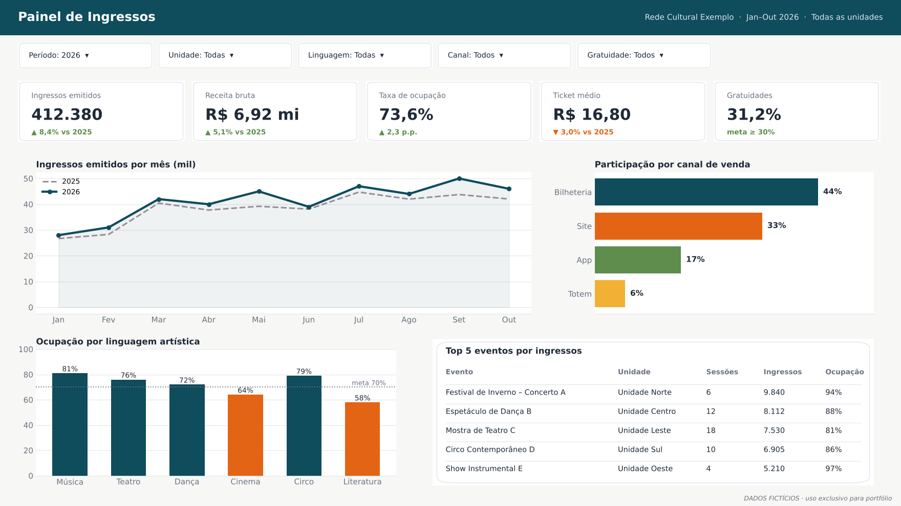

# Portfólio · Análise de Dados e BI

Sou analista de dados em uma instituição cultural e educacional de grande porte. Trabalho com **Power BI, SQL e Python** para transformar dados operacionais em informação para gestão. Também construo **agentes de IA no Microsoft Copilot Studio** que automatizam tarefas repetitivas. Dois deles reduziram em **87,5%** o tempo de análises que levavam dois dias.

> 🔒 **Sobre a confidencialidade:** todos os projetos deste repositório foram recriados com **dados fictícios** e nomes genéricos. As imagens são reproduções ilustrativas e não contêm informações internas da instituição.

---

## Projetos

| # | Projeto | O que resolve | Ferramentas |
|---|---------|---------------|-------------|
| 01 | [Painel de Ingressos](01-painel-ingressos/) | Acompanhamento de vendas, ocupação e gratuidades por unidade e linguagem artística | Power BI · DAX · Power Query |
| 02 | [Agente de Contratos](02-agente-contratos/) | Consulta a contratos em linguagem natural e alertas de vencimento. **Redução de 87,5% no tempo de análise** | Copilot Studio · Power Automate · Power BI |
| 03 | [Agente de Documentação de Painéis](03-agente-documentacao/) | Gera documentação técnica e manual do usuário a partir do modelo Power BI. **Redução de 87,5% no tempo de documentação** | Copilot Studio · Power Automate |
| 04 | [Agente de Comunicação Administrativa](04-agente-comunicacao/) | Redige e revisa memorandos, comunicados e ofícios conforme o manual de redação | Copilot Studio · Power Automate |
| 05 | [Relatórios Paginados](05-report-builder/) | Relatórios mensais prontos para impressão e envio por e-mail | Power BI Report Builder · SQL |
| 06 | [Consultas SQL](06-consultas-sql/) | Consultas de negócio sobre uma base de vendas de ingressos | SQL |

  

---

## Como eu trabalho

1. **Começo pela pergunta de negócio**, não pela ferramenta.
2. **Modelo bem os dados:** esquema estrela, medidas reutilizáveis e regras de acesso (RLS).
3. **Entrego para quem decide:** cada projeto termina com uma ação possível, e não apenas com um gráfico.
4. **Automatizo o que se repete:** documentação, conferências e alertas.

## Contato

- LinkedIn: [seu-perfil](https://www.linkedin.com/in/SEU-PERFIL) ✏️
- E-mail: ✏️

---

As imagens deste repositório foram geradas pelo script <code>gerar_imagens.py</code> com dados inventados.
